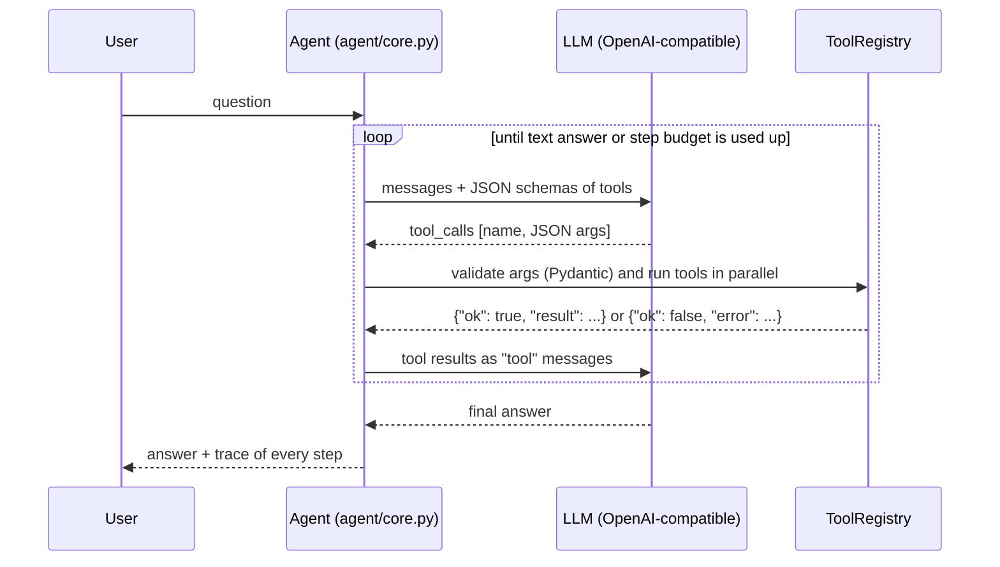

# Tool-Calling AI Agent

[](https://github.com/ilhomjonshoyimov10-cyber/tool-calling-agent/actions/workflows/ci.yml)


An AI agent that decides **which tools to call, calls them, reads the results and answers** — built
from scratch on the OpenAI-compatible function-calling API, without LangChain, so every step of the
loop is visible and tested. It ships with real tools: official Central Bank of Uzbekistan exchange
rates, weather, Wikipedia, a safe calculator, the current time, and a persistent to-do list.
A FastAPI backend serves a small web UI that shows each tool call the agent made.

> 🇺🇿 **O'zbekcha:** AI agent o'zi qaysi vositani chaqirishni hal qiladi: Markaziy bank valyuta kursi,
> ob-havo, Vikipediya, kalkulyator, vazifalar ro'yxati. Har bir qadam (qaysi vosita, qanday argument,
> qanday natija) veb-interfeysda ko'rinadi. LangChain'siz, noldan yozilgan va testlangan.

## What it can do

| Tool | Source | Example request |
|---|---|---|
| `convert_currency` | [cbu.uz](https://cbu.uz) official rates, latest or historical | "100 dollar bugun necha so'm?" |
| `get_weather` | [Open-Meteo](https://open-meteo.com), current + 7-day forecast | "Samarqandda ertaga havo qanday?" |
| `search_wikipedia` | Wikipedia (uz / en / ru) | "Amir Temur haqida qisqacha" |
| `calculator` | local, AST-based (no `eval`) | "1.5 mln so'mni 18 oy yig'sam necha EUR?" |
| `get_current_time` | local clock, any time zone | needed for "tomorrow", "next Friday" |
| `add_task` / `list_tasks` / `complete_task` | SQLite | "Juma kuni hisobot topshirish vazifasini qo'sh" |

The model can chain tools: *"If I save 1.5 million UZS a month for 18 months, how much is that in EUR?"*
→ `calculator` (1 500 000 × 18) → `convert_currency` (UZS → EUR) → answer with the rate date.

## How the agent loop works



Key decisions:

- **One Pydantic model per tool, used twice:** it generates the JSON Schema the model sees, and it validates the arguments the model sends back before any code runs.
- **Errors are observations, not crashes.** Unknown tool, invalid JSON, wrong arguments, an upstream API being down, or a bug inside a tool all come back to the model as `{"ok": false, "error": ...}`, so it can retry or explain. The registry never raises.
- **Parallel tool calls** run concurrently with `asyncio.gather`; results keep their `tool_call_id`.
- **Step budget.** After `MAX_STEPS` rounds the model is called once more *without* tools and must answer with what it has. It is told to say what it could not verify.
- **Provider-specific fields are preserved.** The assistant message is appended exactly as the provider returned it, so data such as Gemini's thought signatures survives the round trip (covered by a test).
- **Lean memory.** Only user questions and final answers are kept per session, not old tool output, so follow-up questions stay cheap.

## Quick start

```bash
cp .env.example .env          # put your LLM_API_KEY (e.g. a free Gemini key) in .env
```

**Docker**

```bash
docker compose up -d --build
open http://localhost:8000
```

**Local**

```bash
python -m venv .venv && source .venv/bin/activate   # Windows: .venv\Scripts\activate
pip install -e ".[dev]"
uvicorn agent.api:app --reload      # web UI on http://localhost:8000
python -m agent.cli                 # or chat in the terminal and watch tool calls
```

Without a key the server still starts; the UI loads and `/api/chat` answers `503` with a clear message.

## API

| Method | Path | Description |
|---|---|---|
| `POST` | `/api/chat` | `{"message": "...", "session_id": "optional"}` → answer, steps, tokens, session id |
| `DELETE` | `/api/sessions/{id}` | Forget a session's history |
| `GET` | `/api/tools` | Names and descriptions of available tools |
| `GET` | `/health` | Liveness check |
| `GET` | `/docs` | Interactive OpenAPI documentation |

Example response:

```json
{
  "session_id": "5f0c…",
  "answer": "…",
  "steps": [
    {"tool": "calculator", "arguments": {"expression": "1500000 * 18"}, "ok": true,
     "result": {"expression": "1500000 * 18", "value": 27000000}, "duration_ms": 0}
  ],
  "total_tokens": 0,
  "stopped_reason": "answer"
}
```

## Tests

```bash
pytest -v
```

43 tests, no network and no API key needed:

- **Agent loop** with a scripted fake model: direct answers, tool round trips, parallel calls, all four failure kinds, the step budget, history and token accounting.
- **Every tool** against mocked HTTP responses (`respx`), including CBU's `Nominal` field (e.g. rates quoted per 10 yen), historical dates, unknown cities and upstream outages. The calculator is tested against code-injection attempts.
- **The real OpenAI adapter** against a mock transport, checking the exact request bodies of a two-turn tool conversation.
- **HTTP API** with FastAPI's `TestClient`: sessions, reset, validation, provider errors (`502`), missing key (`503`).

CI runs lint, format check and tests on Python 3.11–3.13, then builds the Docker image and smoke-tests the running container.

## Project structure

```
agent/
  core.py          the agent loop
  llm.py           ChatModel protocol + OpenAI-compatible adapter
  memory.py        per-session history (LRU)
  api.py           FastAPI app
  cli.py           terminal chat
  config.py        settings
  static/          web UI (single HTML file, no build step)
  tools/
    base.py        Tool interface, schema generation, ToolRegistry
    currency.py    Central Bank of Uzbekistan
    weather.py     Open-Meteo
    wikipedia.py   Wikipedia
    calculator.py  AST-based safe math
    clock.py       current time
    tasks.py       SQLite to-do list
tests/
```

## Add your own tool

```python
from pydantic import BaseModel, Field
from agent.tools.base import Tool


class GreetArgs(BaseModel):
    name: str = Field(description="Who to greet")


class GreetTool(Tool):
    name = "greet"
    description = "Greet a person by name."
    Args = GreetArgs

    async def run(self, args: GreetArgs) -> dict:
        return {"greeting": f"Salom, {args.name}!"}
```

Register it in `agent/tools/__init__.py` → `default_registry()`. The schema, validation and error handling come for free.

## Limitations

- Sessions live in process memory; use Redis or a database for several server instances.
- The to-do list is a single shared list with no authentication. It is a demo of state-changing tools, not a multi-user product.
- Answers are returned when complete (no token streaming yet).

## License

[MIT](LICENSE) © 2026 Ilhomjon Shoyimov
